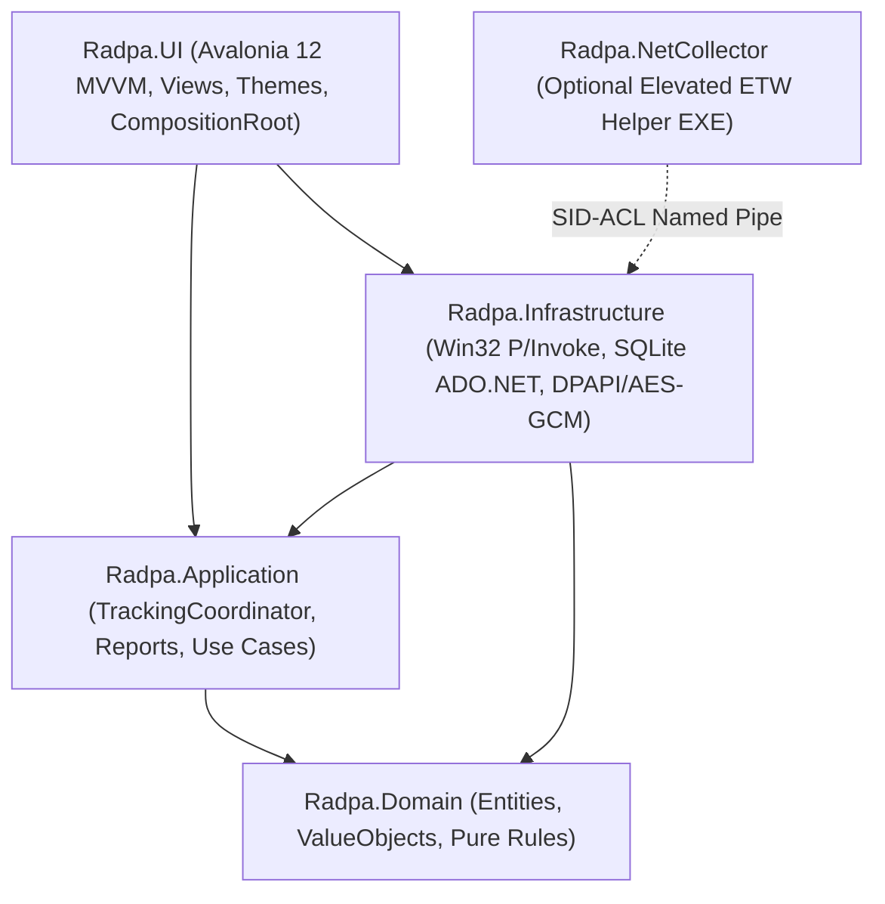
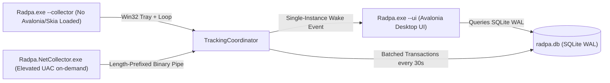
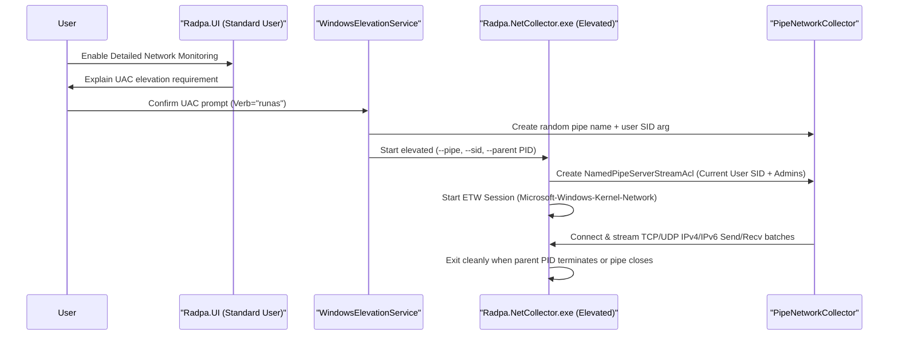

# Radpa System Architecture

Radpa is designed as a **Modular Monolith** inside a single `.NET 10` solution (`Radpa.sln`) with strict inward dependency flow and zero ORM or runtime-reflection bloat.

## 1. Layering & Dependency Direction

- **`Radpa.Domain`**: Zero external dependencies. Holds immutable domain models (`AppIdentity`, `UsageSession`, `ResourceSample`, `NetworkSample`), `TimeRange`, `SessionMerger`, `GroupingResolver`, `ProjectTagMatcher`, `AnomalyDetector`, `HealthScoreCalculator`, `RulesEvaluator`, `SemanticVersion`, and `NumberFormatter`.
- **`Radpa.Application`**: Orchestrates collection (`TrackingCoordinator`), focus sessions (`FocusSessionManager`), transactional field encryption migration (`EncryptionMigrationService`), dashboard & comparison queries (`DashboardQueryService`), AOT-safe report exports (`ReportExporter`), and release update orchestration (`UpdateCoordinator`).
- **`Radpa.Infrastructure`**: Direct Windows internals via source-generated `[LibraryImport]` P/Invoke (`Kernel32Interop`, `User32Interop`, `PdhAndShellInterop`), Toolhelp32 + `RegisterWaitForSingleObject` process lifetime monitor, `SetWinEventHook` foreground tracking, `GetLastInputInfo` idle detection, power/session state detection, WDDM PDH GPU counters, plain parameterized ADO.NET SQLite WAL storage (`SqliteUsageRepository`), `DpapiKeyProtector` + `AesGcmEncryptionService`, asynchronous reverse DNS cache (`ReverseDnsCache`), adapter classifier (`InterfaceClassifier`), ETag-aware `GitHubUpdateChecker`, `RollingFileLogger`, and native Win32 `Win32TrayHost`.
- **`Radpa.UI`**: Compiled-binding (`x:CompileBindings="True"`) Avalonia 12 desktop views, CommunityToolkit.Mvvm source-generated ViewModels, zero-reflection `Localizer` (Persian RTL default + English LTR), bundled subsetted `Vazirmatn UI` font resources, and `DrawingContext`-based charts (`HorizontalBarChartControl`, `TimelineChartControl`).
- **`Radpa.NetCollector`**: Isolated helper executable encapsulating `Microsoft.Diagnostics.Tracing.TraceEvent` (`Microsoft-Windows-Kernel-Network`). Never runs at startup; launched elevated on demand only when the user opts into detailed per-endpoint network reporting.

---

## 2. Runtime Process Architecture & Memory Discipline

To stay well below the background memory budget while offering a rich Fluent dashboard:
1. Launching `Radpa.exe` ensures a lightweight `--collector` background instance is active and launches the UI (`--ui`) as a child/peer process.
2. When the user closes the window (`MinimizeToTray = true`), the **UI process exits completely**, releasing Skia, XAML visual trees, and GPU compositor buffers back to Windows while `Radpa.exe --collector` continues sampling cleanly via its native Win32 `Shell_NotifyIconW` tray host.
3. Clicking the tray icon or re-launching `Radpa.exe` signals a named Windows `EventWaitHandle` to reopen the UI immediately.

---

## 3. On-Demand Elevated Network Collection Flow

